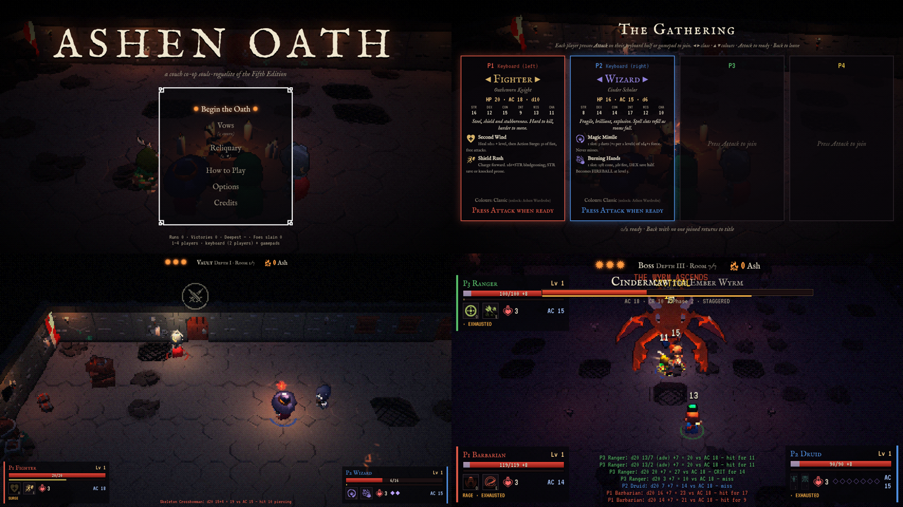

# ASHEN OATH

*A couch co-op souls-roguelite of the Fifth Edition.*



1–4 local players descend through three procedurally generated Depths. The
combat is souls-like (stamina, dodge i-frames, telegraphed attacks, poise,
bonfire checkpoints, dropped currency) and the rules are D&D 5e: every
attack is a real d20 roll that tumbles out as a 3D die, with saving throws,
advantage, death saves, spell slots and class features. Pick branching rooms,
draft boons, bond pacts with your friends, and fight three multi-phase bosses.

The look is **"Ashcore"**: a PSX/PS2-era filter over CC0 asset packs, with
240p rendering, vertex wobble, affine texture warp, woodcut ink outlines,
per-depth tonal ramps that unify the different art packs, 15-bit colour and
ordered dithering. Every part of the filter can be toggled in Options.

> The other two game concepts I designed (a time-loop deckbuilder and a
> dungeon-building colony sim) are in [`docs/GAME_IDEAS.md`](docs/GAME_IDEAS.md).

## Play it (Windows, macOS, Linux; no engine, no install)

1. Download or clone this repository.
2. Open **`play/index.html`** in a modern browser (Chrome, Edge, Firefox or
   Safari 16+). Double-clicking it is enough: it runs straight from disk,
   offline, with no server.

Plug in gamepads before or during the character select screen. Everything is
also playable with two people on one keyboard.

### Controls

| Action            | Keyboard 1 (left) | Keyboard 2 (right) | Gamepad |
|-------------------|-------------------|--------------------|---------|
| Move              | W A S D           | Arrow keys         | Left stick / D-pad |
| Attack            | Space             | `/` or Numpad 0    | X |
| Heavy attack      | C                 | `,` or Numpad 3    | RT |
| Dodge roll        | Left Shift        | `.` or Numpad 1    | A |
| Skill 1           | Q                 | `;` or Numpad 4    | LB |
| Skill 2           | E                 | `'` or Numpad 5    | RB |
| Potion            | R                 | `]` or Numpad 6    | Y |
| Interact / revive | F                 | Enter              | B |
| Pause             | Esc               | Backspace          | Start |

Players join on the **Gathering** screen by pressing *Attack* on their device.

## How it plays

- **Classes:** Fighter, Rogue, Wizard, Druid (Barbarian and Ranger are
  unlocked in the Reliquary). Each has 5e ability scores, AC, hit dice, saving
  throw proficiencies, two skills and features at levels 3/5/7/9.
- **Combat:** d20 + proficiency + modifier vs AC. Natural 20s crit (double
  dice) and natural 1s fumble. Advantage comes from flanking, backstabs,
  staggered or prone foes, Hunter's Mark and more. Area attacks call for
  saving throws. Skeletons are vulnerable to bludgeoning, shades resist steel,
  and so on.
- **Souls-like:** stamina, dodge i-frames, poise breaks, red telegraphs. At
  0 HP you are *downed* and roll death saves while allies hold Interact to
  revive you. A party wipe spends an **Ember** and returns you to the last
  **Ember Shrine**, but your **Ash** stays where you fell until you reclaim it.
- **Roguelite:** choose between doors marked Battle, Elite, Vault, Ash Cache,
  Peddler, Dicer's Altar, Trial or Shrine. Draft boons (feats, magic items,
  spell-pacts) after fights. Three boons of one pact give an *Attunement*;
  two players with two each form a *Pact Bond* that both share. Spend Ash at
  shrines to level up (1–10).
- **Meta:** earn Oath Marks, spend them in the Reliquary, and swear Vows for
  harder runs and bigger rewards.

## Building from source

The playable build in `play/` is committed. To rebuild after changing `src/`:

```bash
npm install
```

```bash
npm run build
```

`npm run watch` rebuilds the code on change. `npm run check` runs a headless
smoke test (it needs Playwright installed).

### Tech

- **three.js** for rendering, plus a custom PSX post-process and material patch
  (`src/render/psx.js`)
- **rot.js** for seeded RNG and cellular-automata room generation
- **howler.js** for audio
- **Fontsource** fonts (IM Fell English, VT323)
- **esbuild** bundles everything. `tools/build.mjs` packs every asset into
  `play/data/pack-*.js` as data URIs, so the game runs from `file://` with
  no server.

## Credits and licences

All art and audio are free assets, mostly CC0. Full credits are on the
in-game Credits screen, and the licence files are in
[`assets/licenses/`](assets/licenses/).

- **3D:** KayKit (Kay Lousberg): Adventurers, Skeletons, Character
  Animations, Dungeon Remastered, Board Game Bits (CC0). Quaternius:
  Ultimate Monsters (CC0).
- **2D:** Dungeon Crawl Stone Soup tiles (CC0). Kenney: Particle Pack,
  Smoke Particles, Light Masks, Fantasy UI Borders (CC0). game-icons.net
  (CC BY 3.0: Lorc, Delapouite, Skoll and others).
- **Audio:** Kenney RPG Audio, Impact Sounds, Interface Sounds, Music Loops,
  Music Jingles, Fighter Voiceover (CC0). Ninja Adventure music by
  Pixel-boy & AAA (CC0).
- The assets were sourced through the `series-ai/jam-ready-assets`,
  `crawl/tiles` and `game-icons/icons` GitHub repositories.

D&D 5e mechanics are referenced under the SRD 5.1 (CC BY 4.0). This is not
affiliated with Wizards of the Coast.
